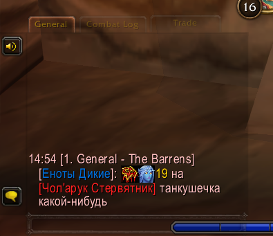

# ChatPlayerInfo

**Shows who is talking in chat:** the player's class icon, race icon and level appear right in front of their message.

*Русское описание ниже.*

## Features

- **Class, race and level next to every message.** The class icon, the race icon (male or female, as the character looks) and the level. Icons follow the font size of the chat window. The game's own icons are used, nothing extra is loaded.
- **Accurate levels.** The game does not send a level with chat messages, and its own player cache keeps an old level after a player levels up. ChatPlayerInfo takes the level from the freshest source it has: players near you (target, focus, mouseover, nameplates), your party or raid, your guild and communities (the guild list is refreshed every 2 minutes), and your friends list. It remembers when each level was last confirmed.
- **A gray level may be out of date.** A level nobody has confirmed for 30 minutes is shown in gray. Max-level players never turn gray, and the max level is taken from the game, so this keeps working if the level cap is raised.
- **Click a gray level to check it.** The addon asks the game with `/who` and replaces the gray number with the fresh one, also in the lines that are already in the chat. Works for players of your own faction (the game's `/who` does not show the other faction), at most once every 5 seconds.
- **Unknown level?** A gray `?` is shown instead, and a click finds the level the same way.
- **Skull for dangerous enemies.** A player of the other faction who is 10 or more levels above you gets a skull, like on the target frame, and the real level next to it when it is known.
- **Yellow or channel-colored level.** By default an up-to-date level is yellow, like on the target frame. Turn this off to show it in the color of the chat channel. An out-of-date or unknown level is gray either way.
- **Works in all player chats.** Say, Yell, numbered channels (General, Trade, LFG and custom channels), Guild, Officer, Party, Raid, raid warnings and Instance chat, including messages from leaders, and whispers: in your own whispers the icons belong to the player you are writing to.
- **Remembers levels.** Confirmed levels survive `/reload` and logging out. A level that has not been confirmed for 12 hours is forgotten.
- **Careful with special cases.** Messages protected by the game during chat lockdown (boss fights and so on) stay in the standard look.
- **Lightweight and safe.** Uses only the standard chat message filter: no Blizzard functions are overridden and nothing is hooked. It works only when a message arrives or the game reports a change, never every frame, and keeps very little data.
- English and Russian.

## How to use

Install it and it works: every new message in the supported chats gets the icons and the level.

Settings: **Options → AddOns → ChatPlayerInfo**, or type `/cpi` (or `/chatplayerinfo`). You can turn off each part separately:

- **Level**, and under it **Yellow level** (available while Level is on);
- **Class**;
- **Race**.

Changes apply to new messages.

## Installation

Install it with the CurseForge app, or download the archive from [GitHub Releases](https://github.com/Ahri-ninetailed/ChatPlayerInfo/releases) and unpack the `ChatPlayerInfo` folder into `World of Warcraft\_forever_\Interface\AddOns`.

Game version: **WoW Forever**.

Source code and bug reports: [GitHub](https://github.com/Ahri-ninetailed/ChatPlayerInfo)

---

# ChatPlayerInfo (Русский)

**Показывает, кто пишет в чат:** иконка класса, иконка расы и уровень игрока стоят прямо перед его сообщением.

## Возможности

- **Класс, раса и уровень у каждого сообщения.** Иконка класса, иконка расы (мужская или женская, как выглядит персонаж) и уровень. Иконки подстраиваются под размер шрифта окна чата. Используются иконки самой игры, ничего лишнего не загружается.
- **Точный уровень.** Игра не передаёт уровень вместе с сообщением, а её собственный кэш игроков хранит старый уровень, даже когда игрок уже вырос. ChatPlayerInfo берёт уровень из самого свежего источника: игроки рядом с вами (цель, фокус, наведение мыши, таблички над головой), ваша группа или рейд, гильдия и сообщества (список гильдии обновляется каждые 2 минуты), список друзей. Аддон запоминает, когда каждый уровень подтверждали последний раз.
- **Серый уровень может быть устаревшим.** Уровень, который никто не подтверждал 30 минут, показывается серым. Игроки максимального уровня серыми не становятся, а сам максимум берётся у игры, так что всё продолжит работать, если потолок уровней поднимут.
- **Нажмите на серый уровень, чтобы проверить его.** Аддон спрашивает игру через `/who` и меняет серую цифру на свежую, в том числе в строках, которые уже есть в чате. Работает для игроков своей фракции (`/who` в игре не показывает другую фракцию), не чаще раза в 5 секунд.
- **Уровень неизвестен?** Вместо него показывается серый `?`, и клик узнаёт уровень так же.
- **Череп у опасных врагов.** У игрока другой фракции, который на 10 и больше уровней выше вас, стоит череп, как на рамке цели, а рядом настоящий уровень, если он известен.
- **Жёлтый уровень или цвет канала.** По умолчанию свежий уровень жёлтый, как на рамке цели. Если отключить, уровень будет цветом канала чата. Устаревший или неизвестный уровень в любом случае серый.
- **Работает во всех чатах игроков.** «Сказать», «Крик», номерные каналы (Общий, Торговля, Поиск спутников и пользовательские каналы), гильдия, офицерский, группа, рейд, объявления рейда и подземелье, включая сообщения лидеров, и шёпот: в вашем собственном шёпоте показаны иконки того, кому вы пишете.
- **Помнит уровни.** Подтверждённые уровни сохраняются после `/reload` и выхода из игры. Уровень, который не подтверждали 12 часов, забывается.
- **Аккуратен с особыми случаями.** Сообщения, которые игра защищает во время блокировки чата (бои с боссами и т.п.), остаются в стандартном виде.
- **Лёгкий и безопасный.** Использует только стандартный фильтр сообщений чата: не переопределяет функции Blizzard и ничего не перехватывает. Работает только когда приходит сообщение или игра сообщает об изменении, а не каждый кадр, и хранит совсем немного данных.
- Английский и русский языки.

## Как пользоваться

Установил, и всё работает: у каждого нового сообщения в поддерживаемых чатах появляются иконки и уровень.

Настройки: **Настройки → AddOns → ChatPlayerInfo** или команда `/cpi` (или `/chatplayerinfo`). Каждую часть можно отключить отдельно:

- **Уровень**, а под ним **Жёлтый уровень** (доступен, пока включён уровень);
- **Класс**;
- **Раса**.

Изменения применяются к новым сообщениям.

## Установка

Через приложение CurseForge или скачайте архив из [GitHub Releases](https://github.com/Ahri-ninetailed/ChatPlayerInfo/releases) и распакуйте папку `ChatPlayerInfo` в `World of Warcraft\_forever_\Interface\AddOns`.

Версия игры: **WoW Forever**.

Исходный код и сообщения об ошибках: [GitHub](https://github.com/Ahri-ninetailed/ChatPlayerInfo)
